# TaskFlow

TaskFlow is a full-stack task management system. Registered users manage their own tasks (list and Kanban board, search, filters, images, activity history), follow their progress on a dashboard and manage their account, with secure authentication, password reset by email, and optional Google/GitHub sign-in.

It was built for a full-stack developer technical assessment. The required stack is React + TypeScript + React Router + Tailwind on the frontend, Node.js + Express + TypeScript on the backend, and PostgreSQL + Prisma for data.

**Live demo: https://taskflow.boats**. Log in with `demo@taskflow.dev` / `Demo@12345!`, or register (the code is emailed). It runs on Cloudflare Workers and Containers with PostgreSQL on Neon; see [deploy/cloudflare](deploy/cloudflare/README.md).

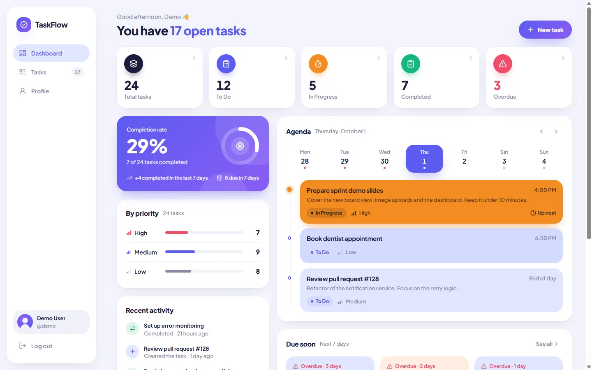

<table>
  <tr>
    <td>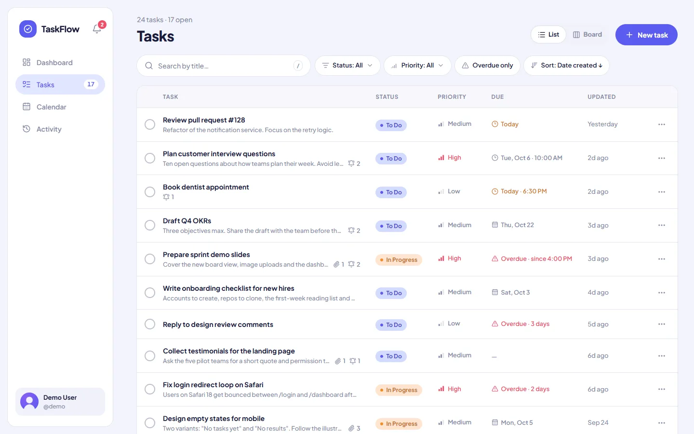</td>
    <td>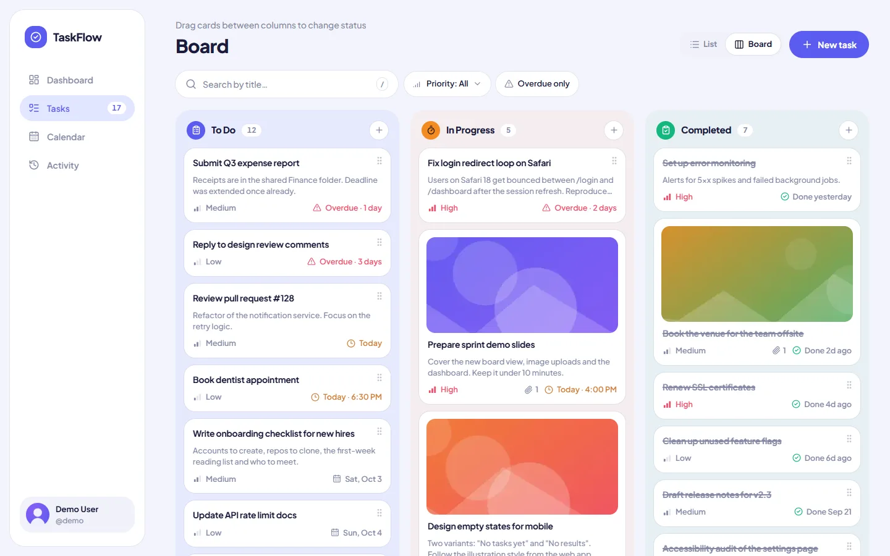</td>
  </tr>
  <tr>
    <td>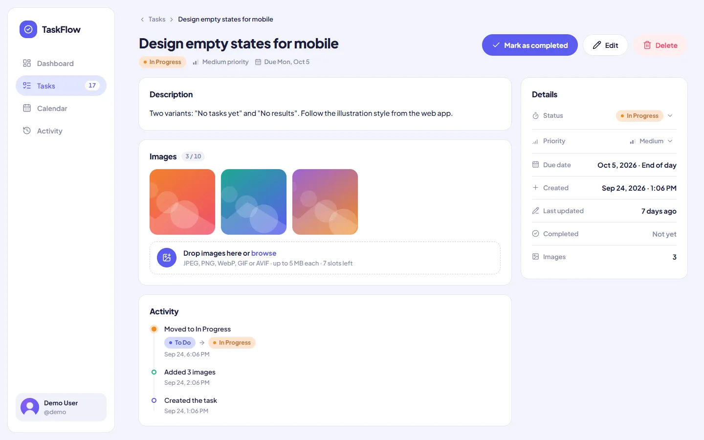</td>
    <td>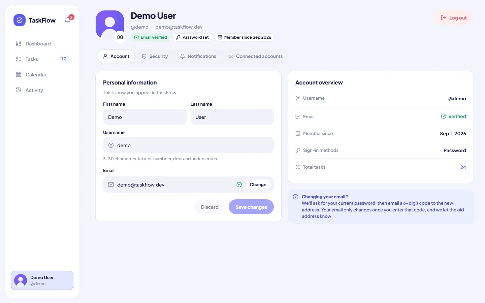</td>
  </tr>
  <tr>
    <td>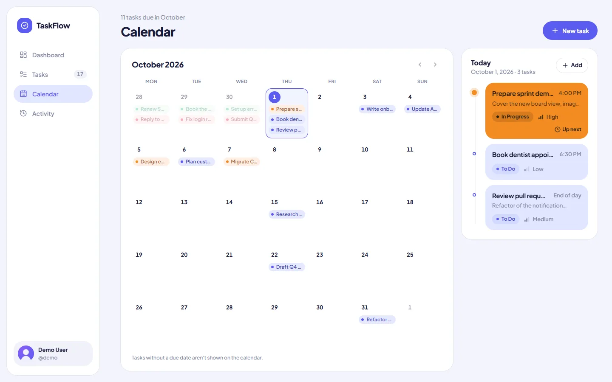</td>
    <td>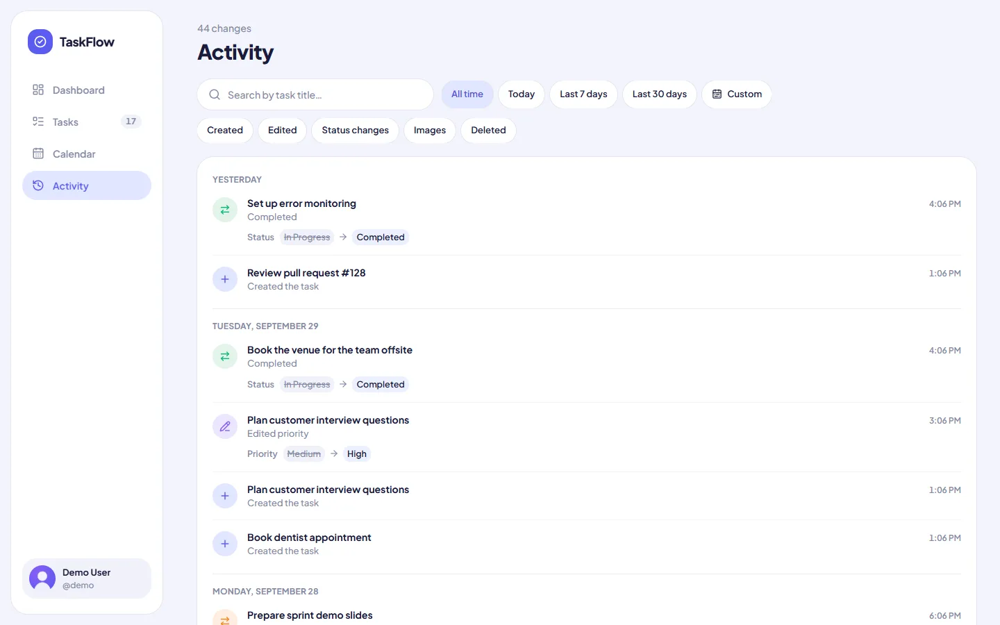</td>
  </tr>
  <tr>
    <td>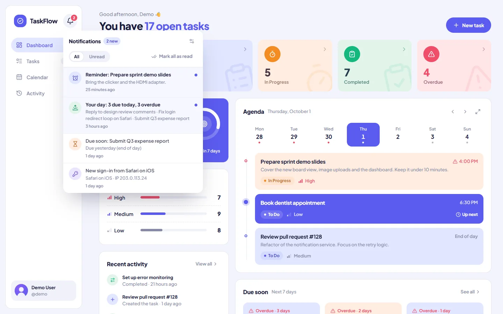</td>
    <td>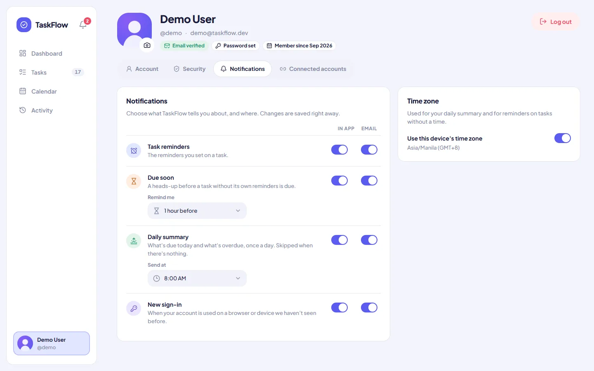</td>
  </tr>
  <tr>
    <td>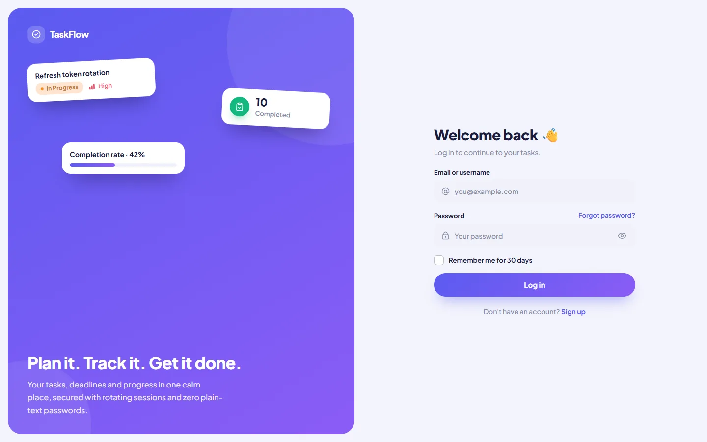</td>
    <td align="center">
      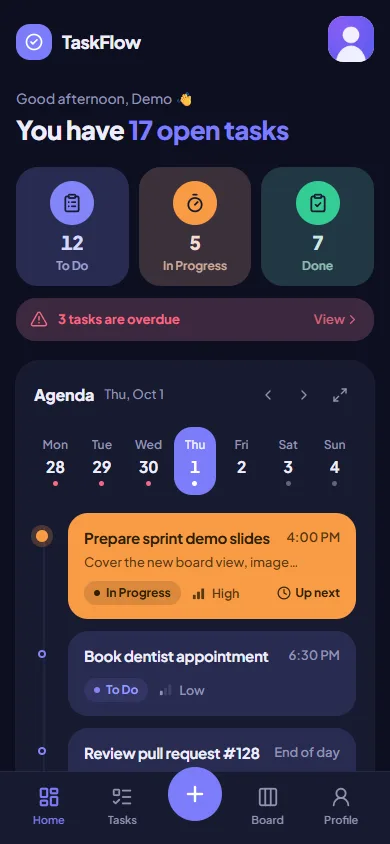
      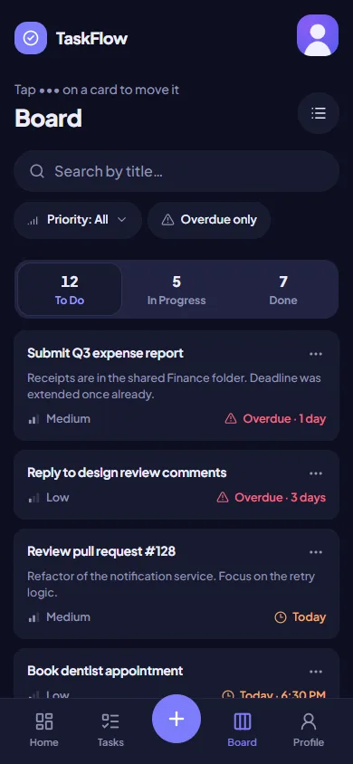
    </td>
  </tr>
</table>

- [Features](#features)
- [Technologies](#technologies)
- [Prerequisites](#prerequisites)
- [Quick start](#quick-start)
- [Environment variables](#environment-variables)
- [Database setup and Prisma migrations](#database-setup-and-prisma-migrations)
- [Running the backend](#running-the-backend)
- [Running the frontend](#running-the-frontend)
- [Demo accounts](#demo-accounts)
- [Testing forgot/reset password emails](#testing-forgotreset-password-emails)
- [Tests](#tests)
- [API](#api)
- [How it works](#how-it-works)
- [Project structure](#project-structure)
- [Optional setup: S3/R2 storage and OAuth](#optional-setup-s3r2-storage-and-oauth)
- [Challenges](#challenges)
- [What I would improve](#what-i-would-improve)

## Features

**Authentication**

- Register with first name, last name, username, email, password and confirmation. Everything is validated on the client and on the server (with shared Zod schemas), including uniqueness and a password policy. The policy requires 8+ characters with upper and lower case, a number and a symbol; it rejects passwords that contain your username or email and passwords found in known breaches ([HIBP k-anonymity](https://haveibeenpwned.com/API/v3#PwnedPasswords)).
- **Email OTP on sign-up:** the account is created only after the user enters the 6-digit code emailed to them. Codes expire after 10 minutes, 5 wrong codes cancel the sign-up, and a new code can be requested after 60 seconds.
- Log in with email **or** username, optionally with "Remember me". The session survives page refreshes (httpOnly cookies with refresh-token rotation).
- Forgot and reset password by email:
  - the response never reveals whether an account exists;
  - reset tokens are random, stored only as a hash, expire after 30 minutes and are single-use;
  - a reset signs out every device.
- Log out, log out of all devices, and a list of active sessions (browser and OS) with revoke.
- **Bonus:**
  - email confirmation with 6-digit codes: at sign-up, and when changing the email (the new address must confirm before the change happens);
  - change or set your password while logged in;
  - Google and GitHub sign-in with explicit account linking;
  - rate limiting and brute-force protection.

**Task management**

- Dashboard:
  - totals by status and priority, overdue, due soon, and completion rate, all computed in the database;
  - a week agenda that expands into a full **month calendar**;
  - recent activity.
- Tasks have a title, description, status (To Do / In Progress / Completed), priority (Low / Medium / High), a due date with an optional time, and created, updated and completed timestamps.
- Views:
  - a list/table with search by title, status and priority filters, an overdue filter, sorting and pagination (all kept in the URL);
  - a Kanban board with drag and drop;
  - a task details page.
- Create and edit in a dialog, with a confirmation before destructive actions.
- **Images** on tasks and a **profile picture**:
  - converted to WebP with sharp;
  - private (served only to their owner);
  - removal can be undone during a retention period.
- **Calendar page:** a month view of tasks by due date, with arrow-key navigation, a selected-day timeline and "Add" on that day.
- **Activity page:** the full history across tasks, grouped by day, with before → after values. Filters by time range (today, 7 or 30 days, custom) and type (created, edited, status, images, deleted), plus title search, all kept in the URL.
- **Activity history** per task as well.
- **Notifications and reminders:**
  - up to 5 reminders per task, each "before the due time" (it follows the due date when that changes) or at a fixed time, with an optional message of your own;
  - a "due soon" heads-up for tasks without reminders, a daily summary at the time you choose, and an alert when your account signs in from a new browser;
  - delivered in the app (a bell with an unread count) and by email, switchable per type and per channel in Profile → Notifications; every email has a one-click unsubscribe.
- Profile: view and edit names, username and email (with uniqueness checks; changing the email needs the current password). You can also manage your avatar, password, sessions and connected accounts.
- Light and dark themes, a responsive layout (sidebar on desktop, bottom tab bar on phones), keyboard shortcuts, and loading, empty, error and success states throughout.

**Data ownership:** every task, image and activity query is scoped to the signed-in user in the backend. Another user's resource answers `404 Not Found`, exactly like one that does not exist (see [Authorization](#authorization-and-data-ownership)).

## Technologies

| Area              | Technologies                                                                                                                                                                                                                                                      |
| ----------------- | ----------------------------------------------------------------------------------------------------------------------------------------------------------------------------------------------------------------------------------------------------------------- |
| Frontend          | React 19, TypeScript 6, Vite 8, React Router 8, Tailwind CSS 4, shadcn/ui (Radix), TanStack Query 5, React Hook Form + Zod, date-fns, dnd-kit, lucide-react, sonner                                                                                               |
| Backend           | Node.js 24, Express 5, TypeScript 6, Prisma 7 (PostgreSQL driver adapter), Zod 4, argon2 (argon2id), jose (JWT and Google ID token verification), BullMQ, ioredis, rate-limiter-flexible, Nodemailer, sharp, multer, AWS SDK v3 (S3/R2), pino, helmet, Swagger UI |
| Data and services | PostgreSQL 17, Redis 8 (sessions cache, rate limits, job queues), Mailpit (development email inbox), SeaweedFS (optional S3-compatible storage)                                                                                                                   |
| Shared            | `@taskflow/shared` workspace: Zod schemas, constants and DTO types used by both frontend and backend                                                                                                                                                              |
| Quality           | Vitest, Supertest, Testing Library, ESLint 10, Prettier, GitHub Actions workflow                                                                                                                                                                                  |

## Prerequisites

- **Node.js 24** or newer (npm 11)
- **Docker Desktop** (or Docker Engine + Compose). It runs PostgreSQL, Redis and Mailpit. If you prefer, install PostgreSQL 17 and Redis 7+ yourself (see [Database setup](#database-setup-and-prisma-migrations)).
- Git

## Quick start

> **New to this?** [**SETUP.md**](SETUP.md) is a plain step-by-step guide, with Docker and without it (installing PostgreSQL and Redis yourself), with every setting already filled in.

With **Node.js 24+** and **Docker Desktop running**, one command sets everything up and starts the app:

```bash
git clone https://github.com/Cjake28/taskflow-app.git
cd taskflow-app
npm run quickstart
```

Open **http://localhost:5173** and log in with `demo@taskflow.dev` / `Demo@12345!` (more in [Demo accounts](#demo-accounts)) or register.

`npm run quickstart` runs the setup, then `npm run dev`. The setup ([`scripts/setup.mjs`](scripts/setup.mjs)):

1. installs the dependencies of every workspace;
2. creates `backend/.env` from `backend/.env.example` with a random `JWT_ACCESS_SECRET` (an existing `.env` is kept);
3. starts PostgreSQL, Redis and Mailpit with `docker compose up -d --wait`;
4. applies the Prisma migrations;
5. loads the demo accounts.

It stops with a hint when something is missing (Docker not running, a port already in use, the database unreachable) and is safe to run again.

**Step by step** (the same thing):

```bash
npm install          # installs every workspace (shared, backend, frontend)
npm run setup        # .env, Docker services, migrations, demo data
npm run dev          # API on :4000 + web app on :5173
```

Next time, `npm run dev` is enough (with Docker running).

**Without Docker:** install PostgreSQL 17 and Redis 7+ (see [Database setup](#database-setup-and-prisma-migrations)), copy `backend/.env.example` to `backend/.env` and set `DATABASE_URL`, `DATABASE_URL_TEST` and `REDIS_URL`, then run `npm run quickstart -- --no-docker`. Add `--no-seed` to skip the demo data.

| URL                                 | What                                                     |
| ----------------------------------- | -------------------------------------------------------- |
| http://localhost:5173               | Web app (Vite proxies `/api` to the API)                 |
| http://localhost:5173/api/docs      | API documentation (Swagger UI)                           |
| http://localhost:4000/api/v1/health | Health check (database, Redis, storage)                  |
| http://localhost:8025               | Mailpit inbox (every email the app sends in development) |

`npm run setup` generates `JWT_ACCESS_SECRET`. To make one yourself:

```bash
node -e "console.log(require('crypto').randomBytes(48).toString('base64url'))"
```

> **Ports already in use?** Override Docker host ports in a root `.env` (`TASKFLOW_POSTGRES_PORT`, `TASKFLOW_REDIS_PORT`, `TASKFLOW_SMTP_PORT`, `TASKFLOW_MAILPIT_UI_PORT`, `TASKFLOW_S3_PORT`), and update `DATABASE_URL` / `REDIS_URL` / `SMTP_PORT` in `backend/.env` to match. The API port is `PORT` in `backend/.env`. For the web app, create `frontend/.env.local` with `WEB_PORT` and `API_PORT` (see `frontend/.env.example`), and keep `FRONTEND_URL` in `backend/.env` equal to the web app URL.

## Environment variables

The backend validates its configuration with Zod at startup and refuses to start with a clear message when something is missing or invalid. Every variable is listed in [`backend/.env.example`](backend/.env.example); the defaults work with `docker compose`.

| Variable                                                                                                          | Required         | Default                    | Purpose                                                                                     |
| ----------------------------------------------------------------------------------------------------------------- | ---------------- | -------------------------- | ------------------------------------------------------------------------------------------- |
| `DATABASE_URL`                                                                                                    | yes              | —                          | PostgreSQL connection string                                                                |
| `DATABASE_URL_TEST`                                                                                               | for tests        | —                          | Separate database used by the backend test suite                                            |
| `REDIS_URL`                                                                                                       | yes              | —                          | Redis (session cache, rate limits, background jobs)                                         |
| `JWT_ACCESS_SECRET`                                                                                               | yes              | —                          | HMAC secret for access tokens, at least 32 characters                                       |
| `FRONTEND_URL`                                                                                                    | yes              | —                          | Web app origin: used for CORS, the CSRF origin check and links in emails                    |
| `PORT`                                                                                                            | no               | `4000`                     | API port                                                                                    |
| `ACCESS_TOKEN_TTL_MINUTES`                                                                                        | no               | `15`                       | Access token lifetime                                                                       |
| `REFRESH_TOKEN_TTL_DAYS` / `REFRESH_TOKEN_REMEMBER_TTL_DAYS`                                                      | no               | `7` / `30`                 | Refresh session lifetime without / with "Remember me"                                       |
| `PASSWORD_RESET_TTL_MINUTES`                                                                                      | no               | `30`                       | Reset link lifetime                                                                         |
| `OTP_TTL_MINUTES`                                                                                                 | no               | `10`                       | Lifetime of emailed 6-digit codes (sign-up and email change)                                |
| `COOKIE_SECURE`                                                                                                   | no               | `false`                    | Set `true` behind HTTPS                                                                     |
| `TRUST_PROXY`                                                                                                     | no               | `loopback`                 | Express `trust proxy` setting (client IPs for rate limits)                                  |
| `HIBP_ENABLED`                                                                                                    | no               | `true`                     | Check new passwords against Have I Been Pwned (fails open when offline)                     |
| `RATE_LIMIT_SCALE`                                                                                                | no               | `1`                        | Multiplies rate-limit budgets (tests use 1000)                                              |
| `RUN_WORKER_IN_API`                                                                                               | no               | `true`                     | Run background jobs inside the API process; set `false` and run `npm run worker` separately |
| `SMTP_HOST`, `SMTP_PORT`, `SMTP_SECURE`, `SMTP_USER`, `SMTP_PASS`, `MAIL_FROM`                                    | no               | Mailpit (`localhost:1025`) | Outgoing email                                                                              |
| `STORAGE_DRIVER`                                                                                                  | no               | `local`                    | `local`, `s3` or `r2` (see [storage](#optional-setup-s3r2-storage-and-oauth))               |
| `STORAGE_LOCAL_ROOT`                                                                                              | no               | `./storage`                | Folder for the local driver (git-ignored)                                                   |
| `S3_*`, `R2_*`                                                                                                    | with that driver | —                          | Bucket, region, endpoint and credentials                                                    |
| `UPLOAD_MAX_FILE_MB`                                                                                              | no               | `5`                        | Per-file upload limit                                                                       |
| `USER_STORAGE_QUOTA_MB`                                                                                           | no               | `100`                      | Per-user image storage quota                                                                |
| `IMAGE_RETENTION_DAYS`                                                                                            | no               | `7`                        | Removed images stay restorable this long, then a daily job deletes them (`0` = immediately) |
| `ORPHAN_GRACE_HOURS`                                                                                              | no               | `24`                       | Stored files without a database row are removed after this long                             |
| `API_DOCS_ENABLED`                                                                                                | no               | `true`                     | Serve Swagger UI at `/api/docs`                                                             |
| `OAUTH_REDIRECT_BASE_URL`, `GOOGLE_CLIENT_ID`, `GOOGLE_CLIENT_SECRET`, `GITHUB_CLIENT_ID`, `GITHUB_CLIENT_SECRET` | no               | empty                      | OAuth. A provider is enabled only when both of its values are set                           |

The frontend needs no environment variables: it calls the relative `/api/v1`. `frontend/.env.local` is only for changing dev-server ports.

Secrets never go into Git: `.env` files are ignored, and only `.env.example` files are committed.

## Database setup and Prisma migrations

**With Docker (recommended).** `docker compose up -d` starts PostgreSQL 17 with user/password `taskflow`, the `taskflow` database, and a second `taskflow_test` database for the test suite (created by `docker/postgres/init`).

**With your own PostgreSQL:**

```sql
CREATE USER taskflow WITH PASSWORD 'taskflow' CREATEDB;
CREATE DATABASE taskflow OWNER taskflow;
CREATE DATABASE taskflow_test OWNER taskflow;
```

Then point `DATABASE_URL` and `DATABASE_URL_TEST` at them. Redis must also be reachable at `REDIS_URL`.

**Migrations.** The schema lives in [`backend/prisma/schema.prisma`](backend/prisma/schema.prisma) and the SQL migrations in `backend/prisma/migrations`.

```bash
npm run db:migrate                          # development: apply migrations (and create new ones after schema changes)
npm run db:deploy                           # production/CI: apply existing migrations only
npm run db:seed                             # demo data (safe to re-run)
npm run db:studio                           # browse the data in Prisma Studio
npx -w @taskflow/backend prisma migrate reset   # drop and re-create the database, apply the migrations (destroys local data); then npm run db:seed
```

The Prisma client is generated into `backend/src/generated/prisma` automatically before `dev`, `test` and `typecheck`.

## Running the backend

```bash
npm run dev:backend      # node --watch (with tsx) on http://localhost:4000 (API under /api/v1)
npm run worker           # only needed when RUN_WORKER_IN_API=false
```

Background jobs (emails, image purge, avatar import, cleanup) run on BullMQ. By default the worker runs inside the API process, so a single command is enough. In production, set `RUN_WORKER_IN_API=false` and scale `npm run worker` separately; no code changes are needed.

## Running the frontend

```bash
npm run dev:frontend     # Vite on http://localhost:5173
npm run build -w @taskflow/frontend   # production build in frontend/dist
```

`npm run dev` starts both sides together. The Vite dev server proxies `/api` to the backend, so the browser sees a single origin: there is no CORS, the httpOnly cookies just work, and `` tags can load private images with the session cookie.

## Demo accounts

After `npm run db:seed`:

| Email               | Username | Password      | Data                                                                                                                                                                                         |
| ------------------- | -------- | ------------- | -------------------------------------------------------------------------------------------------------------------------------------------------------------------------------------------- |
| `demo@taskflow.dev` | `demo`   | `Demo@12345!` | 24 tasks across every status, priority and due window (overdue, today, this week, later, none), activity history, an avatar, task images, reminders on several tasks and a few notifications |
| `alex@taskflow.dev` | `alex`   | `Alex@12345!` | A few private tasks and an image. Use it to check that one user cannot open another user's task or image by URL                                                                              |

## Testing forgot/reset password emails

In development every email is caught by **Mailpit**; nothing reaches a real inbox.

1. Start the stack (`docker compose up -d` and `npm run dev`).
2. On http://localhost:5173/login click **Forgot password?**, enter a registered email (e.g. `demo@taskflow.dev`) and submit. The page shows the same message for any address.
3. Open **http://localhost:8025**. The "Reset your TaskFlow password" email arrives within a second (it is sent by the background worker).
4. Click **Reset password** in the email. It opens `http://localhost:5173/reset-password?token=…`. The page verifies the link first, then removes the token from the address bar.
5. Choose a new password. You are sent to the login page. The old password no longer works, every session of that account is signed out, and a "password changed" email appears in Mailpit.
6. Open the same link again: it is rejected as already used. Links also expire after `PASSWORD_RESET_TTL_MINUTES` (30).

**Sign-up code (OTP).**

1. Register at http://localhost:5173/register. You land on **Check your email**.
2. In Mailpit, open "123456 is your TaskFlow verification code" (the subject starts with the code).
3. Type or paste the 6 digits. The account is created and you are signed in.

Try a wrong code (it says how many attempts are left), or wait 60 seconds and use **send a new code** (the old code stops working).

**Changing the email (OTP).** On Profile → Account, click **Change** next to the email and enter the new address and your current password. A code goes to the **new** address (check Mailpit). The email changes only after you enter it, and the **old** address receives "Your TaskFlow email was changed".

**Reminders and notifications.** The worker looks for due reminders every minute.

1. Create a task and click **Add reminder**. Pick **Custom date & time** two minutes from now and write a message.
2. Within a minute of that time, the bell shows "Reminder: …" and Mailpit has the email with your message.
3. Click **Unsubscribe** in that email. Only task reminder emails are turned off (see Profile → Notifications); the bell still gets them.
4. Sign in from another browser or a private window. The first browser's bell shows "New sign-in from …", and Mailpit has the alert.

The daily summary goes out at the time set in Profile → Notifications (8:00 by default, in your time zone) when something is due that day or overdue.

**Sending real emails (optional).** Any SMTP provider works through the `SMTP_*` variables. For example, Gmail with an [app password](https://support.google.com/accounts/answer/185833):

```env
SMTP_HOST=smtp.gmail.com
SMTP_PORT=465
SMTP_SECURE=true
SMTP_USER=you@gmail.com
SMTP_PASS=your-16-character-app-password
MAIL_FROM="TaskFlow <you@gmail.com>"
```

## Tests

With the Docker services running:

```bash
npm test                               # shared + backend + frontend
npm run test -w @taskflow/backend      # API tests (Vitest + Supertest against the real taskflow_test database, Redis DB 1)
npm run test -w @taskflow/frontend     # component and unit tests (Vitest + Testing Library, no services needed)
npm run lint && npm run typecheck && npm run format:check
```

- About 500 tests in total: around 240 backend, 225 frontend and 35 shared.
- The **backend** suite covers:
  - registration, login, sessions and refresh rotation;
  - password reset, email verification and OAuth (with a fake provider);
  - task CRUD, filters and ownership;
  - images (processing, storage drivers, serving, retention);
  - the dashboard, rate limits and the error envelope;
  - reminders, the notification scheduler (reminders, due soon, daily summary), the feed, settings, signed unsubscribe links and new sign-in alerts.
- Time-dependent behaviour (token expiry, retention, reminders, time zones and daylight saving) is tested with an injectable clock.
- The **frontend** suite covers:
  - the API client (single-flight refresh), form error mapping and URL state;
  - board ordering, upload checks, cache updates and agenda grouping;
  - profile diffing and the main forms and dialogs;
  - the reminder editor, the notification bell and the notification settings.
- Every flow was also exercised in a real browser with Playwright, against the running app:
  - desktop 1440×900 and mobile 390×844, light and dark;
  - register, log in and out, protected redirects, forgot/reset password through Mailpit, and cross-user access;
  - tasks CRUD, search, filters, board drag and drop, images, profile;
  - a reminder created in the form firing on time, its email and unsubscribe link in Mailpit, and a new sign-in alert.
- Storage on S3: `docker compose --profile s3 up -d` starts SeaweedFS. Then `TEST_STORAGE_DRIVER=s3 S3_TEST_ENDPOINT=http://localhost:8333 npm run test -w @taskflow/backend` runs the storage and image tests against it.
- CI: [`.github/workflows/ci.yml`](.github/workflows/ci.yml) runs format, lint, typecheck, all tests, the web build and a dependency audit, plus the S3 tests against SeaweedFS.

## API

REST API under `/api/v1`, documented interactively at **`/api/docs`** (OpenAPI 3.1 generated from the shared Zod schemas; JSON at `/api/docs/openapi.json`).

- Success: `{ "data": … }`, paginated lists: `{ "data": [...], "meta": { "page", "pageSize", "total", "totalPages" } }`.
- Errors: `{ "error": { "code", "message", "details"?: [{ "field", "message" }], "requestId" } }`. The client branches on `code`. Stack traces and internal messages are never sent; unexpected errors are logged with the request ID and returned as a generic `500 INTERNAL_ERROR`.
- Status codes:
  - `200`/`201` (with `Location`)/`202`/`204`;
  - `400` validation/business rule, `401` not signed in or `TOKEN_EXPIRED`, `403` bad origin (CSRF);
  - `404` (also for other users' resources), `409` duplicate, `413`/`415` uploads, `429` with `Retry-After`, `503` dependency down.

| Area          | Endpoints                                                                                                                                                                                                                                                                                                     |
| ------------- | ------------------------------------------------------------------------------------------------------------------------------------------------------------------------------------------------------------------------------------------------------------------------------------------------------------- |
| Auth          | `POST /auth/register`, `/auth/register/verify`, `/auth/register/resend`, `/auth/login`, `/auth/refresh`, `/auth/logout`, `/auth/logout-all`, `/auth/forgot-password`, `/auth/reset-password/verify`, `/auth/reset-password`                                                                                   |
| OAuth         | `GET /auth/oauth/providers`, `GET /auth/oauth/:provider[?mode=link]`, `GET /auth/oauth/:provider/callback`                                                                                                                                                                                                    |
| Profile       | `GET/PATCH /users/me`, `GET/POST/DELETE /users/me/email`, `POST /users/me/email/verify`, `POST /users/me/email/resend`, `PATCH /users/me/password`, `PUT/DELETE /users/me/avatar`, `GET /users/me/sessions`, `DELETE /users/me/sessions/:id`, `GET /users/me/accounts`, `DELETE /users/me/accounts/:provider` |
| Tasks         | `GET/POST /tasks` (search, `status`, `priority`, `overdue`, `dueFrom`, `dueTo`, `sortBy`, `sortOrder`, `page`, `pageSize`), `GET/PATCH/DELETE /tasks/:id`, `PATCH /tasks/:id/move`, `GET /tasks/:id/activities`                                                                                               |
| Images        | `POST /tasks/:id/images`, `DELETE /tasks/:id/images/:imageId`, `POST /tasks/:id/images/:imageId/restore`, `GET /images/:id?variant=display\|thumb`                                                                                                                                                            |
| Dashboard     | `GET /dashboard/stats`, `GET /activities` (`action`, `from`, `to`, `search`, `page`, `pageSize`)                                                                                                                                                                                                              |
| Notifications | `GET /notifications` (`cursor`, `limit`, `unread`), `GET /notifications/unread-count`, `POST /notifications/read`, `GET/PATCH /notifications/preferences`, `POST /notifications/unsubscribe`, `POST /notifications/unsubscribe/one-click`                                                                     |
| System        | `GET /health`                                                                                                                                                                                                                                                                                                 |

State-changing requests must send an `Origin` header that matches `FRONTEND_URL` (browsers do this automatically). With curl, add `-H "Origin: http://localhost:5173"`.

## How it works

### Architecture

An npm-workspaces monorepo:

- `packages/shared`: Zod schemas, constants and types, shared by both apps so validation rules and API types are identical on both sides.
- `backend`: a modular Express API. Each feature module (auth, users, tasks, images, dashboard, oauth, …) has a **routes → controller → service** split:
  - routes wire middleware (authentication, rate limits, validation);
  - controllers translate HTTP to service calls;
  - services hold the business rules and talk to Prisma.
  - Dependencies are built once in a composition root (`src/container.ts`), in the style of NestJS modules but without the framework. Tests swap parts: an in-memory mail transport, an inline job queue, a controllable clock and fake OAuth providers.
- `frontend`: feature folders (`auth`, `dashboard`, `tasks`, `profile`) on top of reusable UI (`components/ui`, `components/common`, `components/layout`).
  - Server state lives in TanStack Query.
  - Filters, sort, page and view live in the URL.
  - Forms use React Hook Form with the shared Zod schemas.
  - A small typed `fetch` client parses the error envelope and refreshes expired sessions transparently.

### Authentication

- Passwords are hashed with **argon2id**; the hash is never selected by default (Prisma global `omit`) and never returned.
- Login issues two **httpOnly, SameSite=Lax cookies**:
  - `tf_access`: a 15-minute HS256 JWT holding the user and session IDs.
  - `tf_refresh`: an opaque `sessionId.secret` value scoped to `/api/v1/auth`. The database stores only its SHA-256 hash in a `sessions` row.
  - JavaScript can't read either cookie, so an XSS bug cannot steal the session.
- **Staying signed in:**
  - on load the app calls `POST /auth/refresh`;
  - it refreshes shortly before the access token expires;
  - on a `401 TOKEN_EXPIRED` it refreshes once and retries (concurrent requests share one refresh).
- **Refresh rotation:** each refresh replaces the refresh secret.
  - Replaying an old refresh token outside a 30-second grace window (for parallel tabs) is treated as theft and revokes the session.
  - "Remember me" makes the refresh cookie persistent (30 days); otherwise it is a browser-session cookie (7-day server limit).
- **Logout** revokes the session in the database and in the Redis session cache, so the access token stops working immediately, not just when it expires.
- **Protection:**
  - failed logins are throttled per identifier and IP (5 attempts, then a cooldown);
  - every sensitive endpoint is rate-limited through Redis;
  - login takes the same time whether or not the account exists (dummy hash);
  - state-changing requests must come from the app's origin (CSRF);
  - helmet sets security headers.

### Sign-up with an email code (OTP)

1. `POST /auth/register` validates everything first: fields, password policy, breached passwords, and whether the email and username are free. Then:
   - The account is **not** created yet. The details (with the password already hashed with argon2id) are kept in Redis as a pending sign-up for 10 minutes, under a random `registrationId`.
   - A background job generates a random 6-digit code and stores only its HMAC (keyed with a server secret and bound to the `registrationId`). The code itself exists only in the email.
2. `POST /auth/register/verify` checks the code:
   - At most 5 attempts, counted atomically with Redis `INCR`, so parallel guesses can't exceed it; after 5 the sign-up is cancelled.
   - On success the pending record is **claimed by deleting it**, so a code works only once.
   - Only then is the user created (with `emailVerifiedAt` set) and signed in.
3. `POST /auth/register/resend` sends a new code after a 60-second cooldown (5 codes per sign-up); the previous code stops working.

Why the account waits for the code: nobody can occupy an email address or username they can't receive mail for, and there are no half-created accounts to clean up. Google/GitHub sign-ups skip the code because the provider has already verified the email.

### Changing the email (OTP)

1. `POST /users/me/email` asks for the new address **and the current password**. A stolen session alone can't move the account to an attacker's inbox.
2. A 6-digit code is sent to the **new** address. The account keeps its current email meanwhile (`GET /users/me/email` shows the pending change; `DELETE` cancels it).
3. `POST /users/me/email/verify` applies the change only with the right code. The same limits apply as at sign-up, and the code is bound to both the user and the target address.
4. The email is updated as verified, and the **previous** address is told about the change, so the real owner notices if it wasn't them.

Because every address is confirmed with a code before it is used, there are no unverified accounts and no separate "confirm your email" links.

### Password reset

1. `POST /auth/forgot-password` only **enqueues** a job and always answers `202` with the same message. The response and its timing are identical whether or not the email exists, and a per-email limit prevents inbox flooding.
2. The worker looks up the account. If it exists, it creates a 256-bit random token, stores **only its SHA-256 hash** in `verification_tokens` (type `PASSWORD_RESET`, 30-minute expiry, earlier unused tokens deleted), and emails the link.
3. The reset page first calls `POST /auth/reset-password/verify`, so an expired or invalid link is explained before the user types anything.
4. `POST /auth/reset-password` checks the new password policy. In a single transaction it then:
   - **atomically claims** the token (`usedAt IS NULL AND expiresAt > now`), so two concurrent submissions can't both succeed;
   - updates the password hash;
   - revokes every session.

   A "password changed" email follows. The old password and every existing session stop working.

### Authorization and data ownership

- Every protected route runs `authenticate`. It verifies the access token and checks that the session is still active (Redis cache with a database fallback).
- The user ID always comes from the session, never from the request. Request bodies are strict schemas: an unknown field like `userId` is rejected.
- Every query for tasks, images and activities includes the owner, e.g. `findFirst({ where: { id, userId } })`. Updates and deletes load the owned row first, inside the same transaction. Another user's task therefore behaves exactly like a missing one: **404**, not 403, so IDs can't be probed.
- Images are served through `GET /images/:id`:
  - only the owner can read them (`private, no-cache` with ETag revalidation);
  - the headers are `nosniff`, a sandboxing CSP and `Cross-Origin-Resource-Policy: same-origin`;
  - buckets are never public.
- The API tests cover these rules for every route: read, update, move, delete, images and activity.

### Database and Prisma relationships

```
User 1─* Task 1─* Image            (task images; ON DELETE SET NULL, then soft-deleted and purged)
  │        ├─* TaskActivity         (history; survives task deletion with a title snapshot)
  │        └─* TaskReminder         (before the due time or at a fixed time; remindAt, sentAt)
  ├─* Notification                  (in-app feed and de-duplication; task link SET NULL on delete)
  ├─? NotificationPreference        (in-app/email per type, time zone, daily summary time)
  ├─* KnownDevice                   (hashed device cookie, for new sign-in alerts)
  ├─* Session                       (one row per signed-in device; refresh-token hash)
  ├─* VerificationToken             (PASSWORD_RESET / EMAIL_VERIFICATION; hash, expiry, usedAt)
  ├─* OAuthAccount                  (unique per provider account and per user+provider)
  ├─* Image  (owner)                (every image a user uploaded)
  └─? Image  (avatarImageId)        (optional 1–1 profile picture)
```

- UUIDv7 primary keys: unique like UUIDs, but time-ordered, which keeps indexes efficient.
- `timestamptz` timestamps; snake_case table and column names via `@map`.
- Enums: `TaskStatus`, `TaskPriority`, `TokenType`, `ActivityAction`, `OAuthProvider`, `ImageKind`, `NotificationType`.
- Unique constraints on `username`, `email`, token hashes, storage keys and OAuth account pairs.
- Composite indexes shaped by the queries, e.g. `(userId, status, position)` for the board and `(userId, dueDate)` for due-date filters.
- Deleting a user cascades to their data.

Design decisions and the full schema are documented in [`docs/design-spec.md`](docs/design-spec.md) §5.

### Images and background jobs

- **Uploads:**
  - multer keeps uploads in memory with strict limits (5 MB each, 5 per request, 10 per task, a per-user quota);
  - sharp decides whether a file is an image by decoding it, so the client's MIME type and file name are never trusted;
  - SVG, TIFF, HEIC and non-images are rejected, with a 40-megapixel decompression-bomb guard.
- **Processing:**
  - the photo is auto-rotated from its EXIF orientation;
  - every image is re-encoded to **WebP** (display ≤ 1600 px, 400 px thumbnail, 256 px avatar), which strips metadata such as GPS location.
- **Storage** goes through a `StorageDriver` interface: local disk, AWS S3 (or any S3-compatible service) or Cloudflare R2, selected by `STORAGE_DRIVER`.
- **Consistency:** files are written before database rows and deleted if the rows fail. Deletions soft-delete first, so an undo is possible and a row never points to a missing file.
- **BullMQ jobs** (Redis) handle work that shouldn't block a request or needs retries:
  - reset, confirmation and "password changed" emails;
  - OAuth avatar import;
  - daily purge of expired images and sweep of orphaned files;
  - cleanup of old sessions and tokens;
  - the per-minute notification tick and notification emails, and a daily cleanup of old notifications and unused devices.

### Notifications and reminders

- **Reminders** are rows in `task_reminders`:
  - "before the due time" ones store an offset and a computed `remindAt`, recomputed whenever the due date changes;
  - fixed ones store only `remindAt`, which must be in the future when saved;
  - a task without a time is due "by the end of the day", so its reminders count back from 9:00 on that date in the user's time zone (the browser keeps the zone in sync);
  - saving a task replaces its reminders, but one that keeps its id and timing keeps its "sent" state, so editing a task never sends a reminder twice.
- **One scheduler instead of one delayed job per reminder.** A BullMQ job scheduler runs `notifications.tick` every minute on its own queue, and reads what is due from PostgreSQL:
  - reminders whose time has come on open tasks (up to an hour late, e.g. after downtime; older ones show as missed);
  - a "due soon" heads-up for open tasks without reminders of their own;
  - the daily summary for users whose local time just passed their chosen time (skipped when nothing is due or overdue).

  Editing or deleting a task never leaves a stale job behind, because the database is the only source of truth.

- **Exactly once.** Each reminder is claimed with a conditional update (`sentAt IS NULL`). "Due soon" relies on a unique `(userId, dedupeKey)` on `notifications`, and the daily summary claims the user's local date. A retry or a second worker cannot send twice.
- **Channels.** Each event becomes a `notifications` row (the in-app feed, unless in-app is off for that type) and, if email is on, an `email.notification` job. The job checks the setting again, so turning email off also stops emails that were already queued.
- **Unsubscribe.** Every notification email has a link and RFC 8058 `List-Unsubscribe` headers with an HMAC-signed token naming the user and the type.
  - It turns off just that email and needs no sign-in.
  - The one-click endpoint is exempt from the origin check because the token itself authorises it.
- **New sign-in alerts.** Sign-ins set a long-lived, httpOnly `tf_device` cookie (random, stored hashed in `known_devices`). A sign-in from a browser without a known cookie raises an alert; an account's first browser is recorded silently.

### Google and GitHub sign-in (optional)

- Authorization Code flow with PKCE (S256), implemented in a small in-house client (`modules/oauth/providers/oauth2.ts`).
  - The state is stored in Redis for single use and bound to a cookie.
  - Google's ID token signature, issuer, audience and expiry are verified with `jose` against Google's published keys.
- Accounts are matched by the provider's account ID, never by email.
- A new Google/GitHub login never attaches itself to an existing password account with the same email; the user links providers from Profile instead. This prevents pre-account-takeover.
- Disconnecting the last way to sign in is refused.

## Project structure

```
taskflow/
├── packages/shared/          # Zod schemas, constants, DTO types (used by both apps)
├── backend/
│   ├── prisma/               # schema.prisma, migrations, seed.ts
│   ├── src/
│   │   ├── common/           # exceptions, middleware (auth, validation, rate limit, upload), security, utils
│   │   ├── config/           # environment validation
│   │   ├── database/ redis/ storage/ mail/ jobs/ docs/
│   │   ├── modules/          # auth, users, tasks, images, activities, dashboard, notifications, oauth, health
│   │   ├── container.ts      # composition root (dependency wiring)
│   │   ├── app.ts routes.ts server.ts worker.ts
│   └── tests/                # API and unit tests
├── frontend/
│   └── src/
│       ├── app/              # router, providers, error boundaries
│       ├── components/       # ui (shadcn), common, layout, images
│       ├── features/         # auth, dashboard, tasks, calendar, activity, notifications, profile
│       ├── lib/              # api client, query keys, dates, form errors
│       └── styles/           # design tokens (light/dark)
├── docker/ docker-compose.yml
└── docs/                     # design specification and implementation plan
```

## Optional setup: S3/R2 storage and OAuth

**S3-compatible storage (local test with SeaweedFS):**

```bash
docker compose --profile s3 up -d
```

```env
STORAGE_DRIVER=s3
S3_BUCKET=taskflow
S3_REGION=us-east-1
S3_ENDPOINT=http://localhost:8333
S3_FORCE_PATH_STYLE=true
S3_ACCESS_KEY_ID=taskflow
S3_SECRET_ACCESS_KEY=taskflow-secret
```

- **AWS S3:** leave `S3_ENDPOINT` empty and set the real bucket, region and keys.
- **Cloudflare R2:** set `STORAGE_DRIVER=r2` with `R2_ACCOUNT_ID`, `R2_BUCKET`, `R2_ACCESS_KEY_ID` and `R2_SECRET_ACCESS_KEY`; the endpoint and region are derived.
- Keep buckets private in every case: images are always served through the API.

**Google sign-in:**

1. In the Google Cloud Console, create an OAuth client ID of type "Web application".
2. Add the redirect URI `http://localhost:5173/api/v1/auth/oauth/google/callback`.
3. Set `GOOGLE_CLIENT_ID` and `GOOGLE_CLIENT_SECRET`.

**GitHub sign-in:**

1. Under GitHub → Settings → Developer settings → OAuth Apps, create an app with the callback URL `http://localhost:5173/api/v1/auth/oauth/github/callback`.
2. Set `GITHUB_CLIENT_ID` and `GITHUB_CLIENT_SECRET`.

When they are unset, the buttons are hidden and everything else works.

## Challenges

- **Prisma 7.** It moved to a generated client in the source tree, `prisma.config.ts` and driver adapters. Most examples online still use the old setup, so the setup followed the current documentation (global `omit` keeps password hashes out of every query).
- **Toolchain versions.** TypeScript 7 was released during the project but typescript-eslint doesn't support it yet, so TypeScript is pinned to 6.0.3. MinIO's Docker images are no longer published, so S3 testing uses SeaweedFS. The AWS SDK's new default checksums break some S3-compatible services, so checksums are only sent where required.
- **A dependency deprecated mid-project.** npm marked the OAuth client library (`arctic`) and its crypto dependencies "no longer supported". The provider interface kept it isolated, so it was replaced by a ~100-line in-house PKCE client. That also added proper signature verification of Google ID tokens.
- **Sessions that survive refreshes without localStorage tokens.** This needed refresh rotation with a grace window, because parallel tabs refresh at the same time. On the client, a single-flight refresh makes concurrent 401s wait for one refresh instead of racing.
- **Not leaking account existence.** Forgot password always answers the same way and does the lookup in a background job, so response timing gives nothing away. Login takes the same time for unknown users.
- **Keeping the database and object storage consistent** without a shared transaction. Writes are ordered, deletes are soft with retention jobs, and a sweep removes orphaned files.
- **Reminders that fire once, on time, in the user's time zone.**
  - A per-minute tick reading the database replaced per-reminder delayed jobs, which go stale when a task is edited.
  - Atomic claims and de-duplication keys make retries safe.
  - An all-day task's reminders count back from 9:00 local time, using small `Intl`-based helpers tested across daylight-saving changes.
- **A dev server that hung only on Windows.** Under `concurrently`, `tsx watch` never started the API on Windows: each process gets a stdin pipe that is never closed, and the watcher stalled on it. Node's own watch mode with the tsx loader (`node --watch --import tsx`) doesn't read stdin, so the backend now uses that. It was found by running the README from a fresh clone.
- **Due dates across time zones.** An all-day task is stored as the end of that local day, so it only becomes overdue after the day ends. Dashboard windows ("due in the next 7 days") are rolling, so they are correct in any zone.

## What I would improve

- End-to-end browser tests (Playwright) in CI, plus visual regression tests for the main screens.
- Deployment: build and deploy from CI on every merge (today the deploy to Cloudflare is run by hand), and move Redis to a managed instance so queued jobs survive a container restart.
- Real-time updates across devices (WebSocket or SSE) and optimistic concurrency (ETags) for simultaneous edits.
- Collaboration: shared projects, assignees and comments, which the ownership model would extend with membership checks.
- Recurring tasks, push notifications (Web Push) and calendar export.
- Two-factor authentication (TOTP or passkeys).
- Scale the notification tick: batch the daily summary by time zone and spread reminders across workers once there are many users.
- Observability: metrics and tracing for the API and job queues, and alerting on failed jobs.
